# Entity-relationship design (ERD)

Status: **Accepted (Phase 0, 2026-11-27)**. This covers every table planned for phases 1–15, grouped by module. The schema is built one phase at a time, and each phase creates only its own tables.

## Conventions (apply to every table unless stated)

| Item | Rule |
|---|---|
| Primary key | `id` BIGINT UNSIGNED auto-increment. Never exposed outside the backend. |
| Public id | `public_id` CHAR(26) ULID, UNIQUE. Present on every table marked **pid**. URLs and the API use only this. |
| Timestamps | `created_at`, `updated_at` (DATETIME, UTC). Ledgers (marked **append-only**) have `created_at` only and are never updated or deleted. |
| Tenant | **T** = `salon_id` BIGINT UNSIGNED NOT NULL FK → `salons.id`, filled by the `BelongsToSalon` trait and filtered by its global scope. **B** = the table also has `branch_id` FK → `branches.id`. |
| Composite indexes | On tenant tables, `salon_id` is the first column of every composite index. |
| Money | `*_amount` / price columns are BIGINT signed **minor units**. Financial records (bookings, orders, payments, invoices, ledgers, memberships) also carry `currency` CHAR(3). Catalog prices use `salons.currency`. |
| Rates | Percentages are stored as INT **basis points** (`*_bp`, 500 = 5.00 %). |
| Translatable text | Columns typed `json·tr` hold `{"ar": "…", "en": "…"}` (spatie/laravel-translatable). See [spec-review](spec-review.md) item 9. |
| Times | DATETIME columns are UTC. `time` columns hold branch-local wall-clock time (schedules), with the zone taken from `branches.timezone`. |
| Phones | E.164 VARCHAR(20), e.g. `+97455123456`. |
| Enums | VARCHAR(32), backed by PHP enums in `Modules/*/Enums`. No MySQL ENUM type, so adding a value needs no migration. |
| Soft delete | `deleted_at` only where marked **SD**. Business entities are deactivated (`is_active` / `status`), not deleted. |
| Files | Every file is a `media` row. Tables hold `*_media_id` FKs, never raw paths. |

Type shorthand: `big` BIGINT UNSIGNED · `int` INT · `small` SMALLINT · `tiny` TINYINT · `bool` TINYINT(1) · `str(n)` VARCHAR · `text` TEXT · `json` JSON · `dt` DATETIME(UTC) · `date` · `time` · `money` BIGINT minor units · `enum` VARCHAR(32).

---

## 1. Core (platform plumbing)

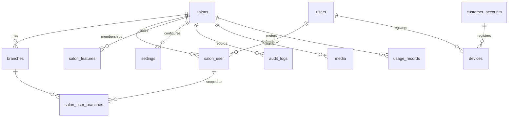

**salons** · pid · SD
`slug` str(63) UQ · `name` json·tr · `legal_name` str(190) · `logo_media_id` FK media · `cover_media_id` FK media · `currency` char(3) default `QAR` · `timezone` str(64) default `Asia/Qatar` · `default_locale` char(2) default `ar` · `country` char(2) · `tax_number` str(50) null · `tax_rate_bp` int default 0 · `contact_phone` · `contact_email` · `social_links` json · `lead_time_minutes` small · `max_days_ahead` small · `cancellation_window_minutes` int · `no_show_fee_amount` money · `custom_domain` str(190) null UQ · `status` enum(active, suspended, closed)
Index: `status`

**platform_admins** (Super Admin guard; not a tenant table)
`name` · `email` str(190) UQ · `password` · `two_factor_secret` text encrypted · `two_factor_recovery_codes` text encrypted · `two_factor_confirmed_at` dt · `last_login_at` dt

**users** (staff identities, global) · pid · SD
`name` str(120) · `email` str(190) null UQ · `phone` str(20) null UQ · `password` · `locale` char(2) · `avatar_media_id` · `two_factor_secret` encrypted · `two_factor_recovery_codes` encrypted · `two_factor_confirmed_at` dt · `last_login_at` dt
Rule: email or phone is required.

**customer_accounts** (app login identity, global) · pid · SD
`phone` str(20) UQ · `name` str(120) · `email` str(190) null · `locale` char(2) · `avatar_media_id` · `phone_verified_at` dt · `deletion_requested_at` dt null · `anonymised_at` dt null

**otp_codes**
`phone` str(20) · `purpose` enum(customer_login, staff_login, phone_change) · `code_hash` char(64) · `attempts` tiny · `expires_at` dt · `consumed_at` dt null · `ip` str(45)
Index: (`phone`, `purpose`, `created_at`)

**personal_access_tokens** (Sanctum) plus the columns `salon_id` big null and `refresh_family` char(26) null. A staff token is bound to exactly one salon membership; a customer token has `salon_id` null. Access tokens expire after 60 minutes.

**refresh_tokens** (added in Phase 1a)
`tokenable_type` · `tokenable_id` · `salon_id` null · `family` char(26) · `token_hash` char(64) UQ · `device_name` · `expires_at` (60 days) · `used_at` null · `revoked_at` null
Single-use and rotating. Presenting a used token revokes its whole family (ADR-002).

**salon_user** (membership) · T
`user_id` FK users · `status` enum(invited, active, deactivated) · `invited_by` FK users null · `invited_at` · `joined_at` · `deactivated_at`
UQ (`salon_id`, `user_id`)

**salon_user_branches** · T
`salon_user_id` FK salon_user · `branch_id` FK branches
UQ (`salon_user_id`, `branch_id`). A membership with no rows here and the Branch Manager or Receptionist role has no branch access. Owner and GM ignore this table.

**roles / permissions / model_has_roles / model_has_permissions / role_has_permissions** (spatie, teams on)
`team_foreign_key` = `salon_id`. `roles.salon_id` null means a platform template role shared by every salon (not copied); assignments carry `salon_id`. UQ (`salon_id`, `name`, `guard_name`).

**staff_invitations** · T
`email` null · `phone` null · `role_names` json · `branch_ids` json · `token_hash` char(64) UQ · `invited_by` FK users · `expires_at` · `accepted_at` null · `accepted_user_id` null

**settings** · T
`settable_type` str · `settable_id` big (salon or branch) · `key` str(100) · `value` json
UQ (`settable_type`, `settable_id`, `key`)

**salon_features** · T
`feature_key` str(64) · `enabled` bool · `source` enum(plan, addon, manual, trial) · `limits` json null · `expires_at` dt null
UQ (`salon_id`, `feature_key`). From Phase 14 this table is computed from plan, add-ons and overrides.

**idempotency_keys**
`key` str(100) · `actor_type` str · `actor_id` big · `salon_id` null · `method` str(8) · `route` str(190) · `request_hash` char(64) · `status` enum(processing, completed) · `response_status` small null · `response_body` mediumtext null · `expires_at` dt (+24 h)
UQ (`actor_type`, `actor_id`, `key`) · Index `expires_at`

**audit_logs** · append-only (`salon_id` is nullable for platform actions)
`actor_type` · `actor_id` · `impersonator_id` null · `event` str(100) (e.g. `service.price_changed`) · `auditable_type` · `auditable_id` · `old_values` json · `new_values` json · `ip` str(45) · `user_agent` str(255) · `device` str(100) · `created_at`
Index: (`salon_id`, `created_at`), (`auditable_type`, `auditable_id`)

**devices**
`owner_type` (user | customer_account) · `owner_id` · `salon_id` null · `app` enum(customer, staff) · `platform` enum(ios, android) · `fcm_token` str(255) UQ · `locale` · `app_version` str(20) · `last_seen_at`

**media** · T · SD
`owner_type` · `owner_id` · `collection` str(50) · `disk` str(30) · `path` str(255) · `mime` str(100) · `size_bytes` int · `width` · `height` · `variants` json · `visibility` enum(private, public) · `contains_pii` bool · `delete_after` dt null
Index: (`owner_type`, `owner_id`, `collection`)

**usage_records** · T · append-only
`meter` enum(ai_generation, whatsapp_message, sms_message, storage_mb, booking) · `quantity` int · `source_type` · `source_id` · `occurred_at`
Index: (`salon_id`, `meter`, `occurred_at`)

---

## 2. Salon (branches)

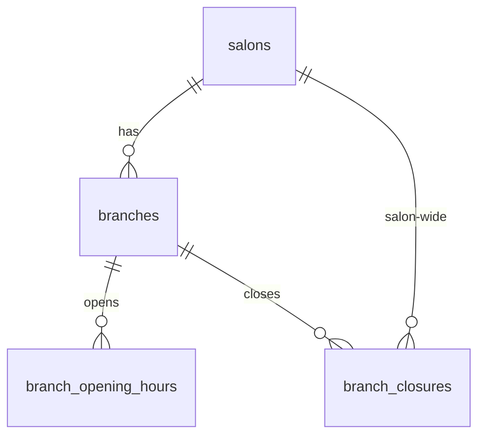

**branches** · pid · T · SD
`name` json·tr · `address` json·tr · `lat` decimal(10,7) · `lng` decimal(10,7) · `phone` · `timezone` str(64) · `is_active` bool · `sort_order` small
Index: (`salon_id`, `is_active`)

**branch_opening_hours** · T · B
`weekday` tiny (0 = Sunday … 6 = Saturday) · `opens_at` time · `closes_at` time. Several rows per weekday give several time ranges.
Index: (`branch_id`, `weekday`)

**branch_closures** · T
`branch_id` null (null = all branches) · `starts_on` date · `ends_on` date · `reason` json·tr
Index: (`salon_id`, `starts_on`)

---

## 3. Staff (barbers and schedules)

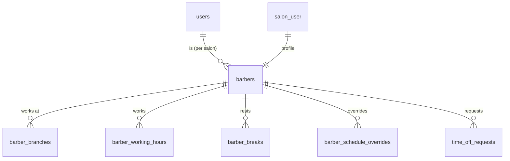

**barbers** · pid · T · SD. This row is the **booking lock key** for the chair (see ADR-004).
`user_id` FK users · `salon_user_id` FK salon_user · `display_name` json·tr · `bio` json·tr · `photo_media_id` · `specialties` json (tag keys) · `years_experience` tiny · `sort_order` small · `is_bookable` bool · `rating_avg` decimal(3,2) cached · `rating_count` int cached
UQ (`salon_id`, `user_id`)

**barber_branches** · T · B
`barber_id` FK · UQ (`barber_id`, `branch_id`)

**barber_working_hours** · T · B
`barber_id` FK · `weekday` tiny · `starts_at` time · `ends_at` time
Index: (`barber_id`, `branch_id`, `weekday`)

**barber_breaks** · T · B
`barber_id` · `weekday` tiny · `starts_at` time · `ends_at` time · `label` str(60)

**barber_schedule_overrides** · T · B
`barber_id` · `date` date · `type` enum(day_off, custom_hours) · `starts_at` time null · `ends_at` time null · `reason` str(190)
Index: (`barber_id`, `date`)

**time_off_requests** · pid · T
`barber_id` · `starts_at` dt · `ends_at` dt · `type` enum(annual, sick, personal, other) · `status` enum(pending, approved, rejected, cancelled) · `reason` text · `decided_by` FK users null · `decided_at` · `decision_note`
Index: (`barber_id`, `status`, `starts_at`)

---

## 4. Catalog (services and pricing)

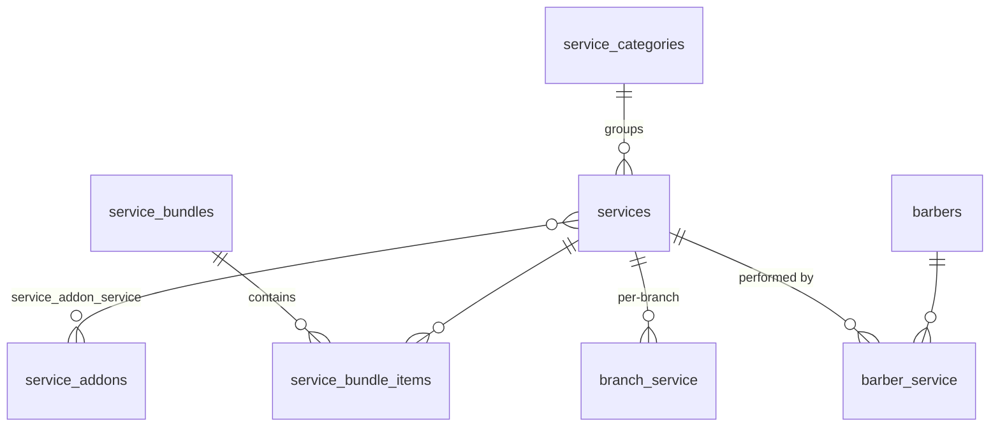

**service_categories** · pid · T · SD
`name` json·tr · `icon` str(60) · `sort_order` small · `is_active` bool

**services** · pid · T · SD
`category_id` FK · `name` json·tr · `description` json·tr · `image_media_id` · `base_price` money · `duration_minutes` small · `buffer_minutes` small · `tax_class` enum(standard, zero, exempt) · `is_active` · `is_bookable_online` · `sort_order`
Index: (`salon_id`, `category_id`, `is_active`)

**service_addons** · pid · T · SD
`name` json·tr · `price` money · `extra_minutes` small · `is_active`

**service_addon_service** · T
`service_addon_id` · `service_id` · UQ pair

**service_bundles** · pid · T · SD
`name` json·tr · `price` money · `is_active`. Duration = the sum of the item durations.

**service_bundle_items** · T
`bundle_id` · `service_id` · `sort_order` · UQ (`bundle_id`, `service_id`)

**branch_service** · T · B
`service_id` · `is_available` bool · `price_override` money null
UQ (`branch_id`, `service_id`)

**barber_service** · T
`barber_id` · `service_id` · `price_override` money null · `duration_override` small null · `commission_rate_bp` int null (placeholder, read by Phase 13)
UQ (`barber_id`, `service_id`)

Price precedence (PricingService): barber override > branch override > base price.

---

## 5. Customer

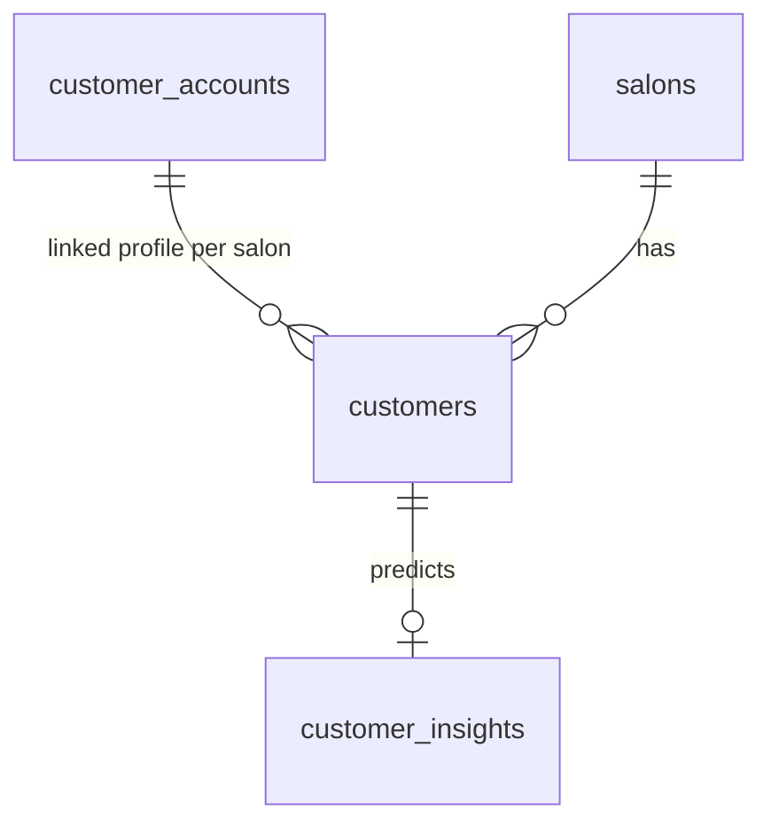

**customers** · pid · T · SD (SD only for anonymisation; financial rows stay linked)
`customer_account_id` FK null (walk-ins without the app have null) · `name` str(120) · `phone` str(20) · `email` null · `birthday` date null · `locale` char(2) · `preferred_barber_id` null · `preferred_branch_id` null · `internal_notes` text (staff only) · `tags` json · `source` enum(app, dashboard, walk_in, phone, import) · `first_visit_at` · `last_visit_at` · `visits_count` int cached · `total_spent_amount` money cached · `no_show_count` small cached
UQ (`salon_id`, `phone`) · Index (`salon_id`, `last_visit_at`), (`customer_account_id`)

**customer_insights** (Smart, Phase 10) · T
`customer_id` UQ · `typical_interval_days` small · `predicted_next_visit_on` date · `last_reminded_at` · `snoozed_until` date · `computed_at`

---

## 6. Booking

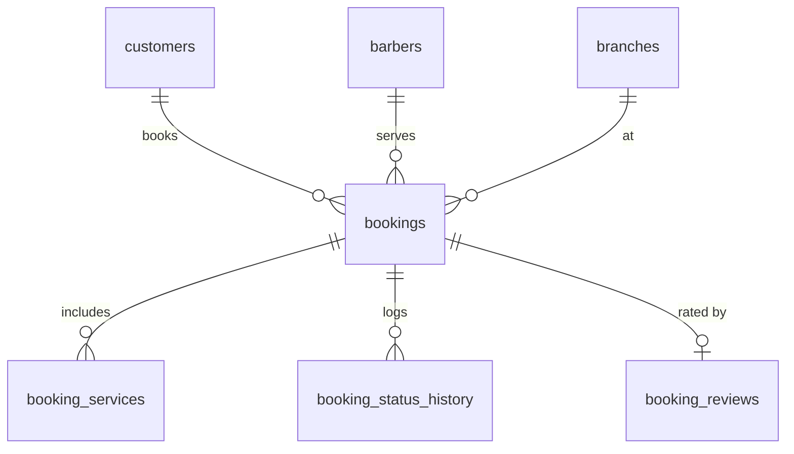

**bookings** · pid · T · B
`customer_id` FK · `barber_id` FK · `starts_at` dt · `ends_at` dt (service end) · `blocked_until` dt (= ends_at + buffer; used for the overlap check) · `status` enum(pending, confirmed, arrived, in_service, completed, cancelled, no_show) · `source` enum(app, dashboard, walk_in, phone, queue) · `customer_notes` text · `internal_notes` text · `cancel_reason` str(255) · `cancelled_by_type` · `cancelled_by_id` · `cancelled_at` · `subtotal_amount` · `discount_amount` · `tax_amount` · `total_amount` · `currency` · `quote_snapshot` json · `reschedule_count` tiny · `created_by_type` · `created_by_id`
Indexes: (`barber_id`, `starts_at`, `blocked_until`) for the overlap check · (`salon_id`, `branch_id`, `starts_at`) for the calendar · (`salon_id`, `customer_id`, `starts_at`) · (`salon_id`, `status`, `starts_at`)
Active statuses for the overlap check: pending, confirmed, arrived, in_service.

**booking_services** · T
`booking_id` · `type` enum(service, addon, bundle) · `service_id` null · `addon_id` null · `bundle_id` null · `name` json·tr snapshot · `price` money snapshot · `duration_minutes` snapshot · `sort_order`

**booking_status_history** · T · append-only
`booking_id` · `from_status` null · `to_status` · `actor_type` · `actor_id` · `reason` str(255) · `meta` json (reschedules store the old and new times) · `created_at`
Index (`booking_id`, `created_at`)

**booking_reviews** · T (see spec-review item 6)
`booking_id` UQ · `customer_id` · `barber_id` · `rating` tiny (1–5) · `comment` text · `is_visible` bool
Index (`barber_id`, `created_at`)

---

## 7. Payment

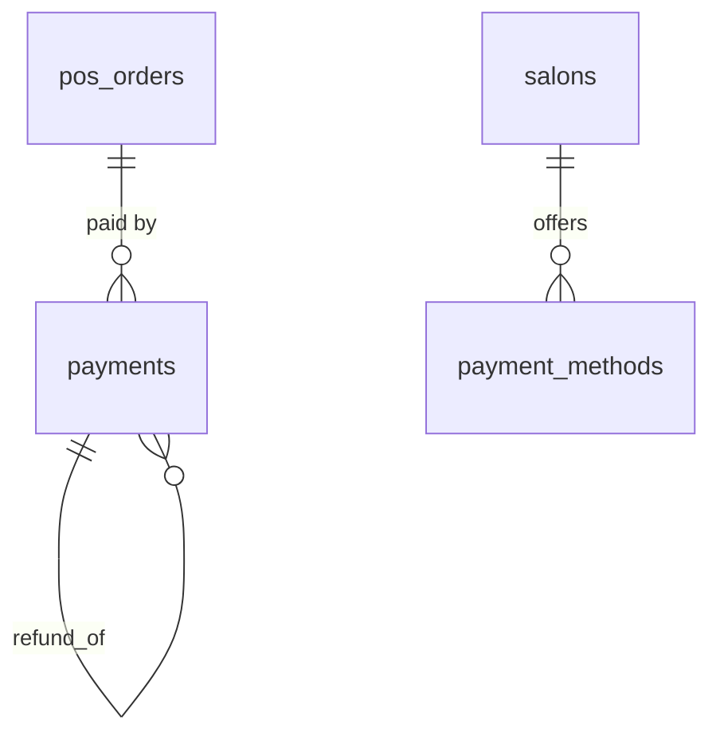

**payment_methods** · T
`code` str(40) · `name` json·tr · `type` enum(cash, card_terminal, online, wallet, other) · `is_active` · `sort_order` · UQ (`salon_id`, `code`)

**payments** · pid · T · B · append-only once `succeeded`
`payable_type` · `payable_id` (pos_order, customer_membership charge) · `customer_id` null · `payment_method_id` · `kind` enum(payment, refund) · `refund_of_payment_id` FK payments null · `amount` money signed (refunds are negative) · `currency` · `status` enum(pending, succeeded, failed, cancelled) · `provider` str(40) null · `provider_ref` str(190) null · `tendered_amount` money null · `change_amount` money null · `cash_shift_id` null · `received_by` FK users null · `meta` json · `succeeded_at`
UQ (`provider`, `provider_ref`) · Index (`salon_id`, `branch_id`, `succeeded_at`), (`payable_type`, `payable_id`)
The only allowed update is pending → succeeded/failed/cancelled. Refunds are new rows.

**gateway_webhook_events** (`salon_id` null until resolved)
`provider` · `event_id` str(190) · `type` · `signature_valid` bool · `payload` json · `processed_at` null · `error` text
UQ (`provider`, `event_id`)

---

## 8. POS and invoices

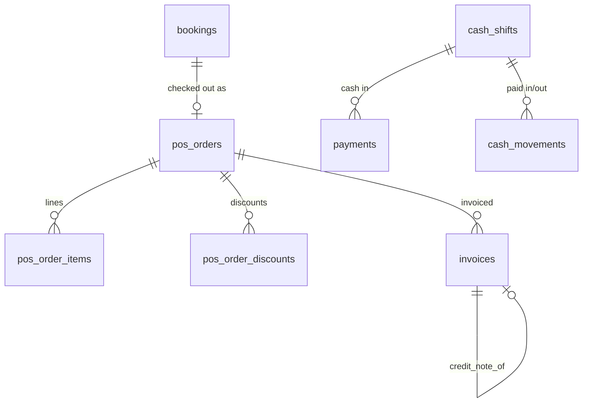

**pos_orders** · pid · T · B
`customer_id` null · `booking_id` null UQ · `status` enum(draft, completed, partially_refunded, refunded, void) · `subtotal_amount` · `discount_amount` · `tax_amount` · `tip_amount` · `total_amount` · `paid_amount` cached · `refunded_amount` cached · `currency` · `cash_shift_id` null · `opened_by` · `completed_by` · `completed_at` · `notes`
Index (`salon_id`, `branch_id`, `completed_at`), (`salon_id`, `customer_id`)
Line items and totals are frozen once `completed`.

**pos_order_items** · T
`pos_order_id` · `type` enum(service, product, addon, tip) · `item_type` · `item_id` null · `name` json·tr snapshot · `quantity` small · `unit_price` money · `discount_amount` · `tax_rate_bp` · `tax_amount` · `line_total` · `barber_id` null · `refunded_quantity` small

**pos_order_discounts** · T
`pos_order_id` · `pos_order_item_id` null · `source` enum(manual, loyalty, membership, offer_code) · `source_ref_type` · `source_ref_id` · `calc` enum(fixed, percent) · `value` int · `amount` money · `reason` str(190) · `applied_by` · `approved_by` null

**invoice_sequences** · T (locked FOR UPDATE when a number is issued)
`kind` enum(invoice, credit_note) · `year` small · `last_number` int · UQ (`salon_id`, `kind`, `year`)

**invoices** · pid · T · B
`pos_order_id` · `kind` enum(invoice, credit_note) · `credit_note_of_id` null · `year` small · `sequence` int · `number` str(40) (e.g. `INV-2027-000123`) · `issued_at` · `seller_snapshot` json · `customer_snapshot` json · `subtotal_amount` · `tax_amount` · `total_amount` · `currency` · `pdf_media_id` null · `e_invoice_payload` json null
UQ (`salon_id`, `kind`, `year`, `sequence`)

**cash_shifts** · pid · T · B
`status` enum(open, closed) · `opened_by` · `opened_at` · `opening_float` money · `closed_by` · `closed_at` · `expected_cash` money · `counted_cash` money · `variance` money · `notes`
Index (`branch_id`, `status`)

**cash_movements** · T · append-only
`cash_shift_id` · `type` enum(paid_in, paid_out) · `amount` · `reason` · `actor_id`

---

## 9. Loyalty

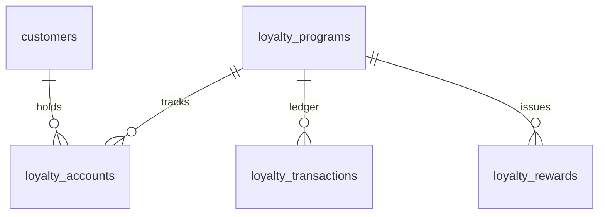

**loyalty_programs** · pid · T · SD
`type` enum(punch_card, points) · `name` json·tr · `is_active` · `starts_at` · `ends_at` · `rules` json (validated by a typed DTO per type: required_count, eligible_service_ids, reward_type, reward_ref, min_spend_amount, expiry_days / earn_rate, redemption_rate, min_redeem, expiry_days) · `branch_ids` json null (null = all)

**loyalty_accounts** (cached balances) · T
`program_id` · `customer_id` · `points_balance` int · `punches` small · UQ (`program_id`, `customer_id`)

**loyalty_transactions** · T · append-only
`program_id` · `customer_id` · `type` enum(earn, redeem, expire, adjust, reverse) · `points` int signed · `punches` small signed · `source_type` · `source_id` · `reverses_id` null · `expires_at` null · `reason` · `actor_type` · `actor_id` · `created_at`
UQ (`program_id`, `source_type`, `source_id`, `type`), which prevents earning twice for the same payment.

**loyalty_rewards** · pid · T
`program_id` · `customer_id` · `status` enum(available, redeemed, expired, voided) · `issued_transaction_id` · `redeemed_transaction_id` null · `expires_at`

---

## 10. Membership

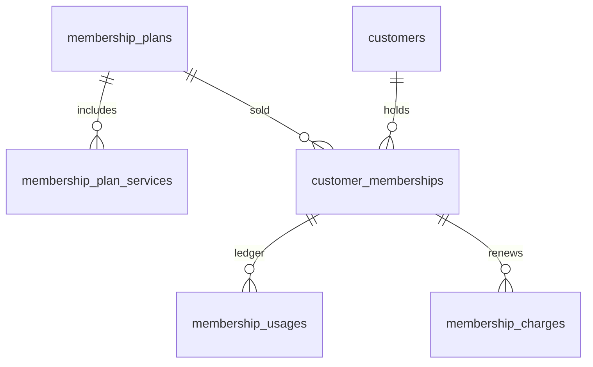

**membership_plans** · pid · T · SD
`name` json·tr · `description` json·tr · `price` money · `period` enum(monthly, quarterly, yearly) · `extras_discount_bp` int · `max_uses_per_day` tiny · `max_pauses_per_term` tiny · `max_pause_days` small · `branch_ids` json null · `is_active`

**membership_plan_services** · T
`plan_id` · `service_id` · `quantity` small null (null = unlimited) · `fair_use_cap` small null · UQ (`plan_id`, `service_id`)

**customer_memberships** · pid · T
`customer_id` · `plan_id` · `status` enum(active, paused, cancelled, expired) · `starts_on` · `ends_on` · `renew_at` · `auto_renew` bool · `gateway_subscription_ref` null · `paused_from` · `paused_until` · `pauses_used` tiny · `cancelled_at` · `price_snapshot` money · `currency` · `active_key` str(64) **generated** = IF(status IN ('active','paused'), CONCAT(customer_id,'-',plan_id), NULL)
UQ (`active_key`): at most one active membership per plan per customer (MySQL has no partial unique index).

**membership_usages** · T · append-only
`customer_membership_id` · `service_id` · `booking_id` null · `pos_order_item_id` null · `type` enum(use, reverse) · `quantity` small signed · `reverses_id` null · `used_at` · `actor_type` · `actor_id`
Index (`customer_membership_id`, `used_at`)

**membership_charges** · T
`customer_membership_id` · `period_start` · `period_end` · `payment_id` null · `status` enum(pending, paid, failed, waived)

---

## 11. Hair history

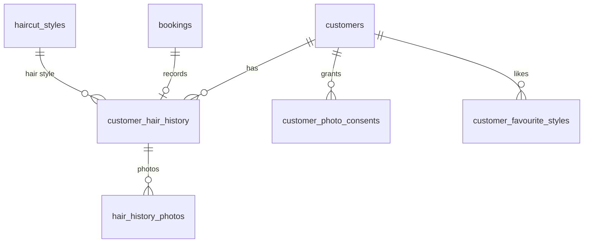

**haircut_styles** · pid · SD (`salon_id` null = platform default)
`name` json·tr · `kind` enum(hair, beard) · `category` enum(fade, crop, classic, textured, long, beard_trim, beard_shape, other) · `image_media_id` · `service_id` null (maps to a service for "Book this style") · `is_active` · `sort_order`

**customer_hair_history** · pid · T · SD
`customer_id` · `booking_id` null UQ · `barber_id` · `hair_style_id` null · `beard_style_id` null · `guard_numbers` json (e.g. `{"sides":1,"top":4}`) · `length_notes` str(190) · `products_used` json · `notes_private` text · `notes_visible` text
Index (`salon_id`, `customer_id`, `created_at`)

**hair_history_photos** · T
`hair_history_id` · `media_id` · `angle` enum(front, left, right, back, top) · `consent_id` FK customer_photo_consents

**customer_photo_consents** · T · append-only
`customer_id` · `action` enum(granted, revoked) · `policy_version` str(20) · `channel` enum(app, staff_device) · `created_at`

**customer_favourite_styles** · T
`customer_id` · `haircut_style_id` · UQ pair

---

## 12. AI Studio

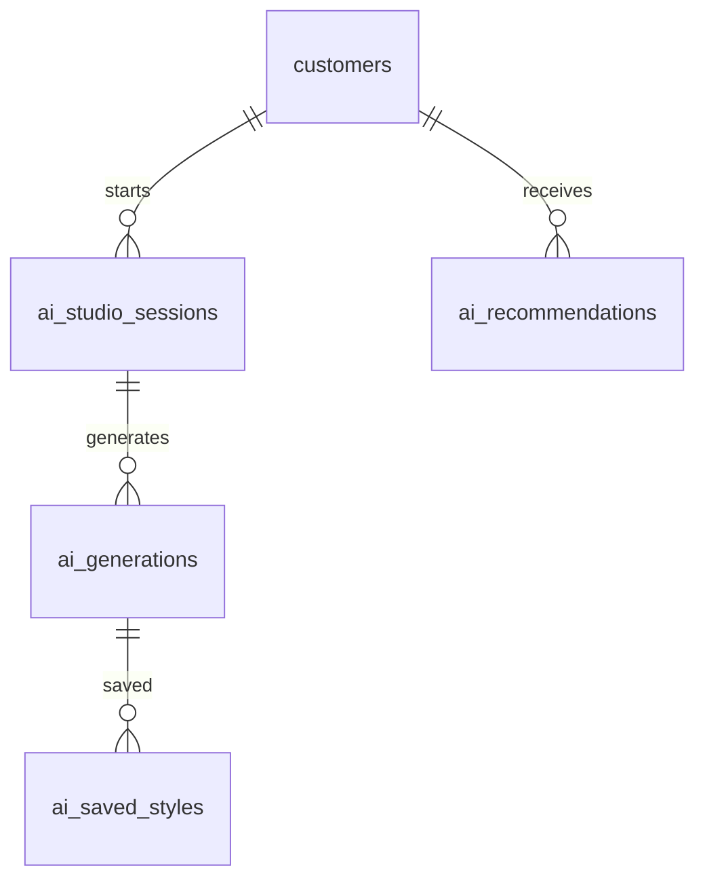

**ai_studio_sessions** · pid · T
`customer_id` · `original_media_id` (never modified) · `status` enum(active, deleted) · `delete_after` dt · `deleted_at`

**ai_generations** · pid · T
`session_id` · `params` json (hairstyle, beard, length, fade, colour) · `result_media_id` null · `provider` str(40) · `model` str(80) · `cost_units` int · `latency_ms` int · `status` enum(queued, processing, succeeded, failed) · `attempts` tiny · `error_code` · `error_message`
Index (`salon_id`, `created_at`)

**ai_saved_styles** · T
`customer_id` · `generation_id` · UQ pair

**ai_recommendations** · T
`customer_id` · `inputs` json · `outputs` json (style ids, reasons) · `provider` · `model` · `created_at`

---

## 13. Smart (rebooking, queue)

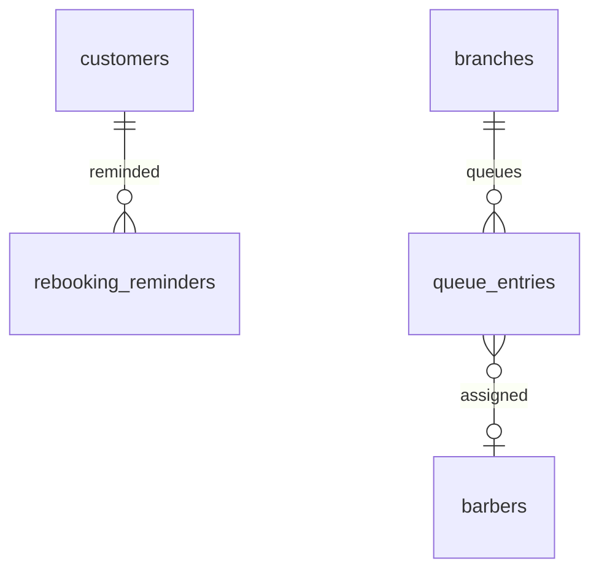

**rebooking_reminders** · T
`customer_id` · `predicted_for` date · `sent_at` · `notification_log_id` null · `outcome` enum(pending, booked, snoozed, ignored) · `snoozed_until` date null

**queue_entries** · pid · T · B
`customer_id` null · `guest_name` · `guest_phone` · `service_ids` json · `preferred_barber_id` null · `assigned_barber_id` null · `booking_id` null · `status` enum(waiting, called, in_service, done, left) · `priority` enum(normal, vip, appointment) · `position` int · `estimated_start_at` dt · `joined_at` · `called_at` · `started_at` · `finished_at` · `left_at` · `source` enum(app, reception, kiosk) · `reorder_reason` str(190)
Index (`branch_id`, `status`, `position`)

Matching weights live in `settings` (key `smart.matching.weights`).

---

## 14. Notification and WhatsApp

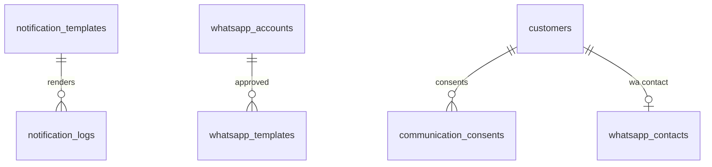

**notification_templates** · (`salon_id` null = platform default)
`event_key` str(80) · `channel` enum(push, in_app, email, whatsapp, sms) · `locale` char(2) · `subject` · `body` text · `whatsapp_template_id` null · `is_active`
UQ (`salon_id`, `event_key`, `channel`, `locale`)

**notification_logs** · T
`notifiable_type` · `notifiable_id` · `event_key` · `channel` · `template_id` null · `campaign_id` null · `status` enum(queued, sent, delivered, read, failed, suppressed) · `provider` · `provider_message_id` · `error` text · `payload` json · `sent_at` · `delivered_at` · `read_at`
Index (`provider`, `provider_message_id`), (`salon_id`, `created_at`)

**notifications** (Laravel database notifications, used by the in-app centre) plus the column `salon_id`.

**notification_preferences** · T
`owner_type` · `owner_id` · `category` enum(booking, reminders, loyalty, marketing, staff_alerts) · `channel` · `enabled` · `quiet_hours` json null
UQ (`owner_type`, `owner_id`, `category`, `channel`)

**communication_consents** · T · append-only
`customer_id` · `channel` · `action` enum(opt_in, opt_out) · `source` (app, STOP keyword, staff, import) · `created_at`

**whatsapp_accounts** · T
`provider` · `waba_id` · `phone_number_id` · `display_number` · `credentials` text encrypted · `status` enum(pending, active, disabled) · UQ (`salon_id`)

**whatsapp_templates** · T
`whatsapp_account_id` · `name` · `language` · `category` enum(utility, marketing, authentication) · `status` enum(approved, pending, rejected, paused) · `components` json · `synced_at` · UQ (`whatsapp_account_id`, `name`, `language`)

**whatsapp_contacts** · T
`customer_id` · `wa_id` · `last_inbound_at` (the 24 h service window) · `opted_out_at` null · UQ (`salon_id`, `customer_id`)

---

## 15. Marketing

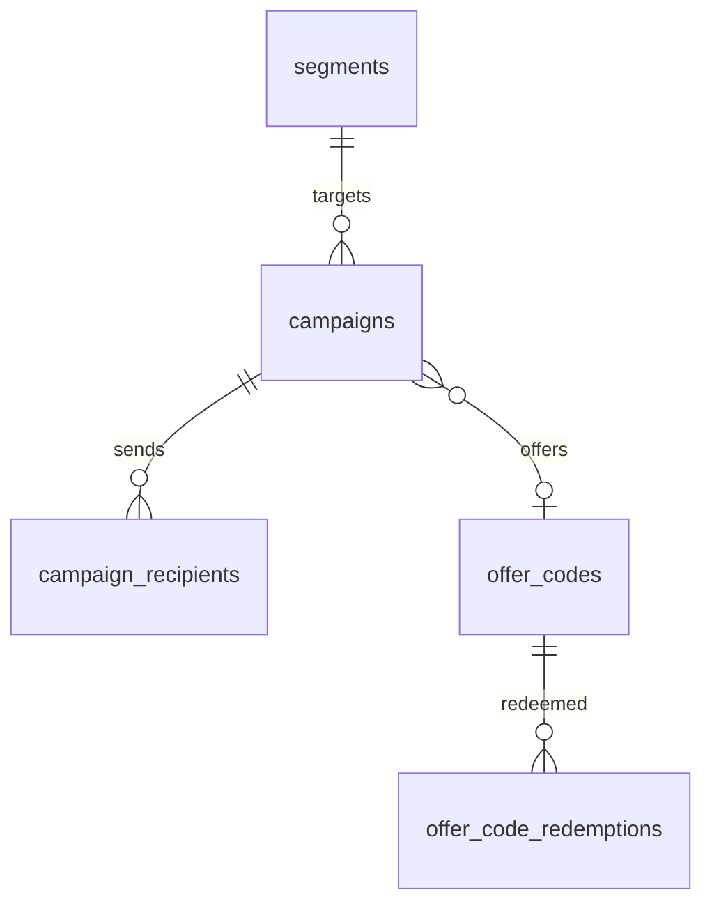

**segments** · pid · T
`name` · `rules` json (typed rule tree) · `cached_count` int · `counted_at`

**campaigns** · pid · T
`name` · `channel` · `template_ref` · `segment_id` · `offer_code_id` null · `variants` json null (A/B) · `scheduled_at` · `status` enum(draft, pending_approval, approved, sending, sent, cancelled) · `created_by` · `approved_by` null · `approved_at` · `frequency_cap_days` small · `stats` json cached

**campaign_recipients** · T
`campaign_id` · `customer_id` · `variant` char(1) · `notification_log_id` null · `status` · `clicked_at` · `attributed_booking_id` null · UQ (`campaign_id`, `customer_id`)

**offer_codes** · pid · T
`code` str(40) · `calc` enum(fixed, percent) · `value` int · `max_uses` int null · `per_customer_limit` small · `service_ids` json null · `starts_at` · `ends_at` · `is_active` · UQ (`salon_id`, `code`)

**offer_code_redemptions** · T · append-only
`offer_code_id` · `customer_id` · `pos_order_id` null · `booking_id` null · `created_at`

**automation_rules** · T
`type` enum(reactivation, birthday, …) · `config` json (e.g. inactive_days 45) · `campaign_blueprint` json · `is_active` · `last_run_at`

---

## 16. Analytics and assistant

**metrics_daily** · T (filled by a scheduled job; read by dashboards)
`date` · `grain` enum(salon, branch, barber, service) · `grain_id` big (0 for salon) · `branch_id_key` big (0 = all branches; not an FK) · `revenue_amount` · `tips_amount` · `refunds_amount` · `bookings_total` · `bookings_completed` · `bookings_cancelled` · `bookings_no_show` · `booked_minutes` · `available_minutes` · `new_customers` · `returning_customers` · `loyalty_points_issued` · `loyalty_points_redeemed` · `membership_mrr_amount` · `currency`
UQ (`salon_id`, `date`, `grain`, `grain_id`, `branch_id_key`)

**assistant_conversations** · pid · T
`user_id` · `title` · `created_at`

**assistant_messages** · T · append-only
`conversation_id` · `role` enum(user, assistant, tool) · `content` text · `tool_calls` json · `tool_results` json · `tokens_in` · `tokens_out` · `created_at`

---

## 17. Inventory

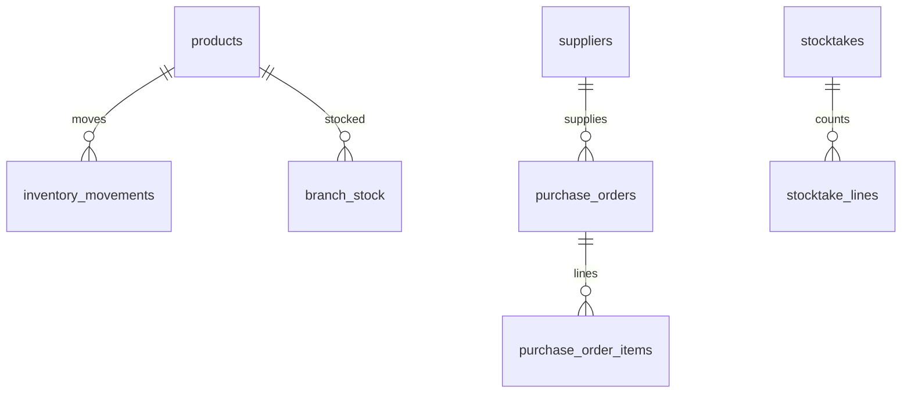

**product_categories** · T · `name` json·tr · `sort_order`

**products** · pid · T · SD
`category_id` · `sku` str(64) · `barcode` str(64) null · `name` json·tr · `cost_amount` · `retail_price` · `tax_class` · `usage` enum(retail, professional, both) · `is_active`
UQ (`salon_id`, `sku`) · Index (`salon_id`, `barcode`)

**suppliers** · T · SD · `name` · `contact` json · `notes`

**purchase_orders** · pid · T · B
`supplier_id` · `status` enum(draft, ordered, partially_received, received, cancelled) · `ordered_at` · `expected_at` · `total_amount` · `currency`

**purchase_order_items** · T · `purchase_order_id` · `product_id` · `qty_ordered` · `qty_received` · `unit_cost`

**branch_stock** (cached sum of movements) · T · B
`product_id` · `on_hand` int · `low_stock_threshold` int · UQ (`branch_id`, `product_id`)

**inventory_movements** · T · B · append-only
`product_id` · `type` enum(purchase, sale, service_use, adjustment, transfer_out, transfer_in, return, stocktake) · `quantity` int signed · `unit_cost` money · `source_type` · `source_id` · `transfer_group` char(26) null · `reason` · `actor_id` · `created_at`
Index (`branch_id`, `product_id`, `created_at`)

**stocktakes** · pid · T · B · `status` enum(counting, completed, cancelled) · `started_by` · `completed_at`

**stocktake_lines** · T · `stocktake_id` · `product_id` · `expected_qty` · `counted_qty` · `variance`

---

## 18. Commission

**commission_rules** · T
`scope` enum(default, category, service, product, barber, barber_service) · `barber_id` null · `target_type` null · `target_id` null · `item_type` enum(service, product, tip) · `calc` enum(percent, fixed) · `value` int · `tiers` json null · `effective_from` date · `effective_to` date null
Precedence (most specific wins): barber_service > barber > service/product > category > default.

**barber_commissions** · T · append-only
`barber_id` · `pos_order_item_id` · `payment_id` · `rule_id` · `type` enum(earn, reverse) · `base_amount` · `commission_amount` signed · `reverses_id` null · `statement_id` null · `occurred_at`
Index (`barber_id`, `occurred_at`)

**commission_statements** · pid · T
`barber_id` · `period_start` · `period_end` · `status` enum(draft, approved, locked) · `services_amount` · `products_amount` · `tips_amount` · `deductions_amount` · `total_amount` · `currency` · `approved_by` · `approved_at`

**commission_deductions** · T · `statement_id` · `amount` · `reason`

---

## 19. Billing (platform; not tenant config)

**subscription_plans** · pid · `code` UQ · `name` json·tr · `is_active` · `sort_order`
**plan_prices** · `plan_id` · `period_months` tiny (1/3/6/12) · `amount` · `currency` · UQ (`plan_id`, `period_months`, `currency`)
**plan_features** · `plan_id` · `feature_key` · `enabled` · `limit_value` int null · UQ (`plan_id`, `feature_key`)
**addons** · pid · `code` UQ · `name` json·tr · `feature_keys` json · **addon_prices** (same shape as plan_prices)
**salon_subscriptions** · T · `plan_id` · `status` enum(trial, active, past_due, grace, suspended, cancelled) · `period_months` · `trial_ends_at` · `current_period_start` · `current_period_end` · `grace_ends_at` · `cancelled_at` · `gateway_ref`
**salon_addons** · T · `addon_id` · `status` · `current_period_end`
**platform_coupons** · `code` UQ · `calc` · `value` · `duration_months` · `max_redemptions` · `expires_at`
**platform_invoices** · pid · T · `number` UQ · `status` enum(draft, open, paid, void) · `subtotal_amount` · `tax_amount` · `total_amount` · `currency` · `due_at` · `paid_at` · **platform_invoice_items**
**dunning_attempts** · T · `platform_invoice_id` · `attempt` · `channel` · `sent_at` · `result`

## 20. Admin (platform)

**impersonation_logs** · `platform_admin_id` · `salon_id` · `user_id` · `reason` text · `ip` · `started_at` · `ended_at`
**support_notes** · `salon_id` · `platform_admin_id` · `body` text
**system_settings** · `key` UQ · `value` json
**provider_health_checks** · `provider` · `status` · `latency_ms` · `checked_at`

---

## Tenant-table checklist

Every table above marked **T** must:
1. use the `BelongsToSalon` trait,
2. appear in the TenantIsolation dataset (`tests/Feature/TenantIsolation`),
3. resolve route bindings by `public_id` *through the scoped query*, so another salon's id returns 404, never 403.

Tables with a nullable `salon_id` (platform defaults: `haircut_styles`, `notification_templates`, `roles`) use a `BelongsToSalonOrPlatform` variant. It reads `salon_id = current OR salon_id IS NULL` and writes only the current salon's rows.
