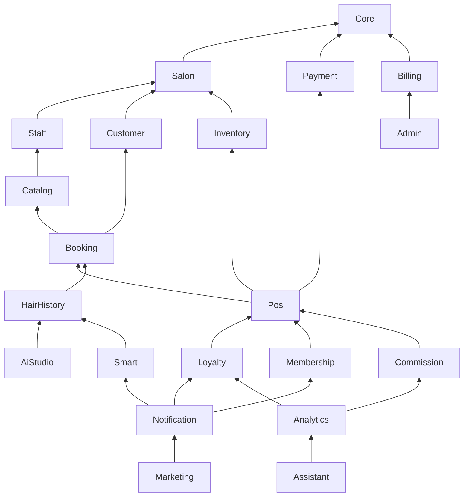

# Module map

Status: **Accepted (Phase 0, 2026-11-27)**. Modules live in `backend/app/Modules/{Name}`. The dependency graph below is acyclic. A module may call another module's **public Actions, Contracts and read-only query services**, and may listen to its **Events**. It never touches another module's Models directly for writes.

## Dependency layers

A module may depend only on modules in **lower** layers. Same-layer modules do not depend on each other.

| Layer | Modules |
|---|---|
| L0 | **Core** |
| L1 | **Salon**, **Payment** |
| L2 | **Staff**, **Customer** |
| L3 | **Catalog** |
| L4 | **Booking**, **Inventory** |
| L5 | **Pos**, **HairHistory** |
| L6 | **Loyalty**, **Membership**, **Commission**, **AiStudio**, **Smart** |
| L7 | **Notification**, **Analytics** |
| L8 | **Marketing**, **Assistant**, **Billing** |
| L9 | **Admin** |

(Arrows mean "depends on". Only the edges that define each module's layer are drawn; transitive dependencies are allowed.)

### How the two upward needs are solved without cycles

1. **Prices need loyalty, membership and offer-code discounts.** `Catalog` owns `PricingService` and declares the contract `Catalog\Contracts\PriceAdjuster` (`adjust(Quote): Quote` and `commit(Quote, Transaction)`). Loyalty, Membership and Marketing register adjusters in their ServiceProviders. Booking and Pos call only `PricingService`, so they never import Loyalty or Membership.
2. **Lower modules need to send notifications** (e.g. Booking reminders in Phase 4). `Core\Contracts\NotificationChannel` is a thin contract. Phase 4 binds a log stub; Phase 11 binds the real `NotificationService`. Lower modules also emit Events that Notification listens to.

Usage metering follows the same idea: `Core\Contracts\UsageMeter::record(salon, meter, qty, source)` writes `usage_records`. AiStudio and Notification call it; Billing reads it.

---

## Modules

### Core (L0)
**Responsibility:** tenancy (`CurrentSalon`, `ResolveSalon`, `BelongsToSalon`, and the tenant-root models `Salon`, `Branch`, `SalonMembership` plus the `CreateSalon`/`AddMember` actions — they live in Core because tenancy needs them; changed in Phase 1a), Money, ULIDs, API envelope + exception → error-code mapper, Idempotency middleware, Audit (`Auditable` trait, `audit_logs`), Settings, Features (`Feature::enabled()`), Media/StorageService, devices, OTP, provider contracts (`SmsProvider`, `PushProvider`, `WhatsAppProvider`, `AiImageProvider`, `AiTextProvider`, `StorageService`, `OtpProvider`, `NotificationChannel`, `UsageMeter`) and their fakes, auth for users, customer accounts and platform admins.
**Public actions:** `IssueOtp`, `VerifyOtp`, `IssueStaffToken`, `IssueCustomerToken`, `RegisterDevice`, `RecordAudit`, `StoreMedia`.
**Emits:** `UserLoggedIn`, `CustomerAccountCreated`, `CustomerAccountDeletionRequested`.
**Listens:** none.
**Depends on:** none.

### Salon (L1)
**Responsibility:** salon profile and booking policy, branch management, opening hours, closures, salon and branch settings UI (on top of the Core `Salon`/`Branch` models).
**Public actions:** `UpdateSalonProfile`, `CreateBranch`, `UpdateBranch`, `DeactivateBranch`, `SetOpeningHours`, `AddClosure`.
**Read services:** `BranchCalendar::openIntervals(branch, dateRange)`.
**Emits:** `SalonCreated`, `BranchCreated`, `BranchUpdated`.
**Depends on:** Core.
**As built (Phase 2):** actions `UpdateSalonProfile`, `UploadSalonImage`, `SaveBranch` (create and update), `SetOpeningHours`, `DeactivateBranch`; closures are added and removed in `BranchController`. Opening hours are read inside `ScheduleService` (no separate `BranchCalendar` yet; it arrives with slots in Phase 4 if needed). Changes are recorded through the `Auditable` trait and `AuditLogger` instead of domain events. `WeekRanges` validates and normalises weekly range input for both modules.

### Payment (L1)
**Responsibility:** payment methods, the `payments` ledger, `PaymentGateway` contract + FakeGateway + one real adapter, webhook intake and processing, refunds as reversal rows.
**Public actions:** `RecordPayment`, `CapturePayment`, `RefundPayment`, `ProcessGatewayWebhook` (job).
**Emits:** `PaymentSucceeded`, `PaymentFailed`, `PaymentRefunded`.
**Depends on:** Core. It knows payables only as a morph and never imports Pos.

### Staff (L2)
**Responsibility:** invitations, memberships and role assignment UI, barber profiles, barber-branch assignment, working hours, breaks, overrides, time off.
**Public actions:** `InviteStaff`, `AcceptInvitation`, `AssignRoles`, `AssignBranches`, `DeactivateStaff`, `UpsertBarberProfile`, `SetWorkingHours`, `RequestTimeOff`, `DecideTimeOff`.
**Read services:** `ScheduleService::workingIntervals(barber, branch, dateRange)` (combines branch hours, closures, barber hours, breaks, overrides and approved time off).
**Emits:** `StaffInvited`, `StaffJoined`, `RolesChanged` (audited), `TimeOffRequested`, `TimeOffDecided`.
**Depends on:** Salon, Core.
**As built (Phase 2):** actions `InviteStaff` (+ `resend`), `AcceptInvitation`, `UpdateMemberAccess` (roles and branches together, audited as `membership.access_changed`), `ChangeMemberStatus` (deactivate or reactivate), `UpdateBarberProfile`, `SetWeeklySchedule`, `RequestTimeOff`, `DecideTimeOff` (+ `cancel`). Core's `MemberAccessChanged` event drives the `SyncBarberProfile` listener, which creates, restores or pauses the barber profile when the barber role is given or removed. Invitations, joins and time-off decisions are audited; `StaffJoined`/`TimeOff*` events are not emitted yet because no listener needs them before notifications (Phase 11).

### Customer (L2)
**Responsibility:** salon-scoped customer profiles, linking to `customer_accounts`, search, merge, anonymisation on deletion, cached visit stats.
**Public actions:** `FindOrCreateCustomer` (by phone), `UpdateCustomer`, `LinkCustomerAccount`, `AnonymiseCustomer`, `MergeCustomers`.
**Listens:** `CustomerAccountDeletionRequested` (anonymises in every salon after the retention check).
**Emits:** `CustomerCreated`.
**Depends on:** Salon, Core.
**As built (Phase 4, minimal):** `Customer` (one per salon and phone, optional account link), `FindOrCreateCustomer` (race-safe on the unique phone), `CustomerSearch`, and the append-only `customer_dues` ledger (no-show fees now; settled at the POS in Phase 6). The full CRM (profiles page, notes, merge, export) is a later phase. **Phase 5:** `AnonymiseCustomer` (spec-review item 12) and the listener `AnonymiseAccountProfiles`. The event named `CustomerAccountDeletionRequested` above is built as Core's `CustomerAccountErasing`. The action emits `CustomerAnonymising` before it erases a profile, so higher modules can clear what they own.

### Catalog (L3)
**Responsibility:** categories, services, add-ons, bundles, branch and barber overrides, **PricingService** (the only place prices are computed), and the `PriceAdjuster` contract.
**Public actions:** `CreateService`, `UpdateService` (audits price changes), `SetBranchPricing`, `AssignBarberServices`, `ReorderCategories`.
**Read services:** `PricingService::quote(services, addons, barber, branch, customer, adjusters…)`, `CatalogQuery::forBranch()`, `EligibleBarbers::for(services, branch)`.
**Emits:** `ServicePriceChanged`.
**Depends on:** Staff, Salon, Core.
**As built (Phase 3):** `PricingService::quote(branch, services, addons, barber, customer, bundles)` returns a `Quote` of `QuoteLine`s (unit price + its source, duration, tax, total) and runs every tagged `PriceAdjuster` (`PriceAdjuster::TAG`); `branchPrices()` and `servicePriceAt()` serve catalog listings. Actions: `SaveCategory`, `ReorderCategories`, `DeleteCategory`, `SaveService`, `SetBranchPricing`, `AssignBarberServices`, `SaveAddon`, `SaveBundle`, `UploadServiceImage`. Every price change is audited as `catalog.price_changed` (scope base, branch, barber, addon or bundle; old/new minor units) and emits `ServicePriceChanged`. `CatalogQuery`/`EligibleBarbers` are not separate classes yet: the public catalog controller and the pricing rules cover them until Booking (Phase 4) needs them.

### Booking (L4)
**Responsibility:** the bookings lifecycle, the status machine, AvailabilityService, the locking create/reschedule path, the calendar broadcast, reminder scheduling, reviews.
**Public actions:** `CreateBooking`, `RescheduleBooking`, `CancelBooking`, `ConfirmBooking`, `MarkArrived`, `StartService`, `CompleteBooking`, `MarkNoShow`, `SubmitReview`.
**Read services:** `AvailabilityService::slots(branch, services, barber|any, date)`.
**Emits:** `BookingCreated`, `BookingConfirmed`, `BookingRescheduled`, `BookingCancelled`, `BookingArrived`, `BookingStarted`, `BookingCompleted`, `BookingNoShow`, `ReviewSubmitted`.
**Listens:** none (it is a source of truth, not a reactor).
**Depends on:** Catalog, Customer, Staff, Salon, Core.
**As built (Phase 4):** `CreateBooking`, `RescheduleBooking`, `CancelBooking` and `ChangeBookingStatus` (confirm, markArrived, startService, complete, markNoShow — the prompt's named actions) on a shared `BookingWriter` (READ COMMITTED transaction, `SELECT … FOR UPDATE` on barbers in ascending id order, hours + overlap re-check) and `TransitionBooking` (row lock, allowed transitions only). `AvailabilityService::slots()` and `nextFree()`; `EligibleBarbers::for()` (the "any" order). Events after commit: `BookingCreated/Confirmed/Cancelled/Rescheduled/Completed` and the broadcast `BookingChanged`. `SendBookingReminder` jobs at 24 h and 2 h through `NotificationChannel`. **Phase 5:**
- **Reviews:** `BookingReview` (one per completed booking; published or hidden), `SubmitReview`, `ModerateReview` (audited), `BarberRating` (the cached `barbers.rating_avg/count`, always recomputed from published reviews) and `BookingReviewPolicy` (`review.moderate`).
- **Customer app:** `CustomerHomeController` (`/customer/salons`, `/customer/home`) and `BookingCalendar` (`.ics`). `CustomerBookings` resolves a booking only through the account's own profiles.
- **Erasure:** the listener `ClearAnonymisedCustomerBookings` (on `CustomerAnonymising`) cancels upcoming bookings and clears booking notes and review comments.

### Inventory (L4)
**Responsibility:** products, suppliers, purchase orders, the movement ledger, branch stock cache, transfers, stocktakes, low-stock alerts.
**Public actions:** `RecordStockMovement` (callable inside a caller's transaction), `ReceivePurchaseOrder`, `TransferStock`, `CompleteStocktake`.
**Emits:** `LowStockReached`.
**Depends on:** Salon, Core.

### Pos (L5)
**Responsibility:** POS orders, items, discounts, checkout, invoices and credit notes, invoice numbering, cash shifts, daily sales reports.
**Public actions:** `OpenOrderFromBooking`, `AddOrderItem`, `ApplyDiscount`, `CompletePosOrder` (prices via PricingService, then RecordPayment, RecordStockMovement and IssueInvoice in one transaction), `RefundOrderItems` (reversal payments + credit note), `VoidDraftOrder`, `OpenShift`, `CloseShift`.
**Emits:** `PosOrderCompleted`, `PosOrderRefunded`, `InvoiceIssued`.
**Listens:** `PaymentSucceeded` (online payments for an order).
**Depends on:** Booking, Inventory, Payment, Catalog, Customer.

### HairHistory (L5)
**Responsibility:** haircut style catalog, hair history records, photo consent, favourites, the "Same as last time" draft.
**Public actions:** `RecordHairHistory`, `GrantPhotoConsent`, `RevokePhotoConsent`, `BuildSameAsLastTimeDraft`.
**Listens:** `BookingCompleted` (opens a pending history capture for the barber).
**Depends on:** Booking, Catalog, Customer, Staff.

### Loyalty (L6)
**Responsibility:** programs, the ledger, cached accounts, rewards, expiry, and a PriceAdjuster for redemptions.
**Public actions:** `EarnForPayment`, `RedeemPoints`, `RedeemReward`, `AdjustBalance`, `ExpirePoints` (scheduled).
**Listens:** `PaymentSucceeded` → earn; `PaymentRefunded` → reverse.
**Emits:** `LoyaltyRewardReady`, `LoyaltyPointsExpiring`.
**Depends on:** Pos, Payment, Catalog, Customer.

### Membership (L6)
**Responsibility:** plans, customer memberships, the usage ledger, renewals, pause and cancel, and a PriceAdjuster that covers included services inside the booking and POS transaction.
**Public actions:** `SellMembership`, `RenewMembership` (scheduled), `PauseMembership`, `ResumeMembership`, `CancelMembership`, `RecordUsage`, `ReverseUsage`.
**Listens:** `PaymentSucceeded` (activate or renew), `PosOrderRefunded` (reverse usage).
**Emits:** `MembershipActivated`, `MembershipRenewed`, `MembershipExpiring`, `MembershipRenewalFailed`.
**Depends on:** Pos, Payment, Catalog, Customer.

### Commission (L6)
**Responsibility:** rules, the earnings ledger, statements, approval and locking, exports.
**Public actions:** `AccrueCommission`, `ReverseCommission`, `GenerateStatement`, `ApproveStatement`, `LockStatement`.
**Listens:** `PosOrderCompleted` → accrue; `PosOrderRefunded` → reverse.
**Depends on:** Pos, Staff, Catalog.

### AiStudio (L6)
**Responsibility:** sessions, generation jobs on the `ai` queue, recommendations, usage limits, privacy deletion.
**Public actions:** `StartSession`, `RequestGeneration`, `SaveStyle`, `DeleteSession`, `RecommendStyles`, `PurgeExpiredOriginals` (scheduled).
**Emits:** `GenerationSucceeded`, `GenerationFailed`.
**Depends on:** HairHistory (styles), Catalog (service mapping), Customer, Core (AiImageProvider, AiTextProvider, UsageMeter).

### Smart (L6)
**Responsibility:** rebooking predictions and reminders, MatchingService, the walk-in queue.
**Public actions:** `ComputeCustomerInsights` (nightly), `SendRebookingReminders`, `SnoozeReminder`, `ScoreBarbers`, `JoinQueue`, `CallNext`, `AssignQueueEntry`, `ReorderQueue`, `LeaveQueue`.
**Listens:** `BookingCompleted`, `BookingStarted` (recalculates queue estimates).
**Emits:** `QueuePositionChanged`, `YouAreNext`, `RebookingDue`.
**Depends on:** HairHistory, Booking, Staff, Customer.

### Notification (L7)
**Responsibility:** NotificationService routing, templates, the in-app centre, logs, preferences, consent, WhatsApp account, templates and webhooks, SMS, email and push sending (all queued).
**Public actions:** `Notify` (implements `Core\Contracts\NotificationChannel`), `SyncWhatsAppTemplates`, `RecordConsent`, `ProcessWhatsAppWebhook`.
**Listens:** the Booking*, Queue*, Membership*, LoyaltyRewardReady, InvoiceIssued, RebookingDue, LowStockReached and TimeOffRequested events.
**Depends on:** Smart, Loyalty, Membership, Pos, Booking, Customer, Core.

### Analytics (L7)
**Responsibility:** `metrics_daily` aggregation, KPI queries, CSV export.
**Public actions:** `AggregateDay` (scheduled), `BackfillMetrics`.
**Read services:** `KpiQuery::*`, which the Assistant tools use.
**Depends on:** read-only access to Commission, Loyalty, Membership, Pos, Booking, Customer.

### Marketing (L8)
**Responsibility:** segments, campaigns with approval, recipients, offer codes (also a PriceAdjuster), automation rules, attribution.
**Public actions:** `EvaluateSegment`, `SubmitCampaign`, `ApproveCampaign`, `SendCampaignBatch` (job), `RunAutomationRules` (scheduled), `RedeemOfferCode`.
**Listens:** `BookingCreated` (attribution).
**Depends on:** Notification, Customer, Catalog, Analytics (read).

### Assistant (L8)
**Responsibility:** the safe tool library, LLM orchestration with function calling, conversations, the number-provenance check.
**Public actions:** `AskAssistant`.
**Depends on:** Analytics, Core (AiTextProvider, UsageMeter).

### Billing (L8)
**Responsibility:** platform plans, add-ons, salon subscriptions, proration, platform invoices, dunning, computing `salon_features`, limit enforcement.
**Public actions:** `StartTrial`, `ChangePlan`, `PurchaseAddon`, `RecomputeSalonFeatures`, `RunDunning` (scheduled), `SuspendSalon`, `ReactivateSalon`.
**Emits:** `SalonSuspended`, `SalonReactivated`, `FeatureSetChanged`.
**Depends on:** Core (Features, UsageMeter), Payment (platform gateway), Salon.

### Admin (L9)
**Responsibility:** the Super Admin console: salons, impersonation, plans, coupons, global audit, provider health.
**Public actions:** `StartImpersonation` (logged and visible to the owner), `EndImpersonation`, `AddSupportNote`.
**Depends on:** Billing and read access to everything.

---

## Enforcement

- A `tests/Architecture` Pest arch test fails the build when a module imports a class from a higher layer or another module's `Models\*` outside its `Contracts\*`, `Actions\*`, `Events\*` or `Queries\*`.
- Each module registers its routes, policies, listeners and price adjusters in its own `ServiceProvider`. Disabling a module's provider must not break lower modules (checked by the arch test).
- Feature gates (`salon_features`): `ai_studio`, `loyalty`, `membership`, `whatsapp`, `marketing`, `advanced_pos`, `inventory`, `commission`, `assistant`, `smart_queue`, `rebooking`. The middleware `feature:{key}` returns `FEATURE_NOT_AVAILABLE` (403).
